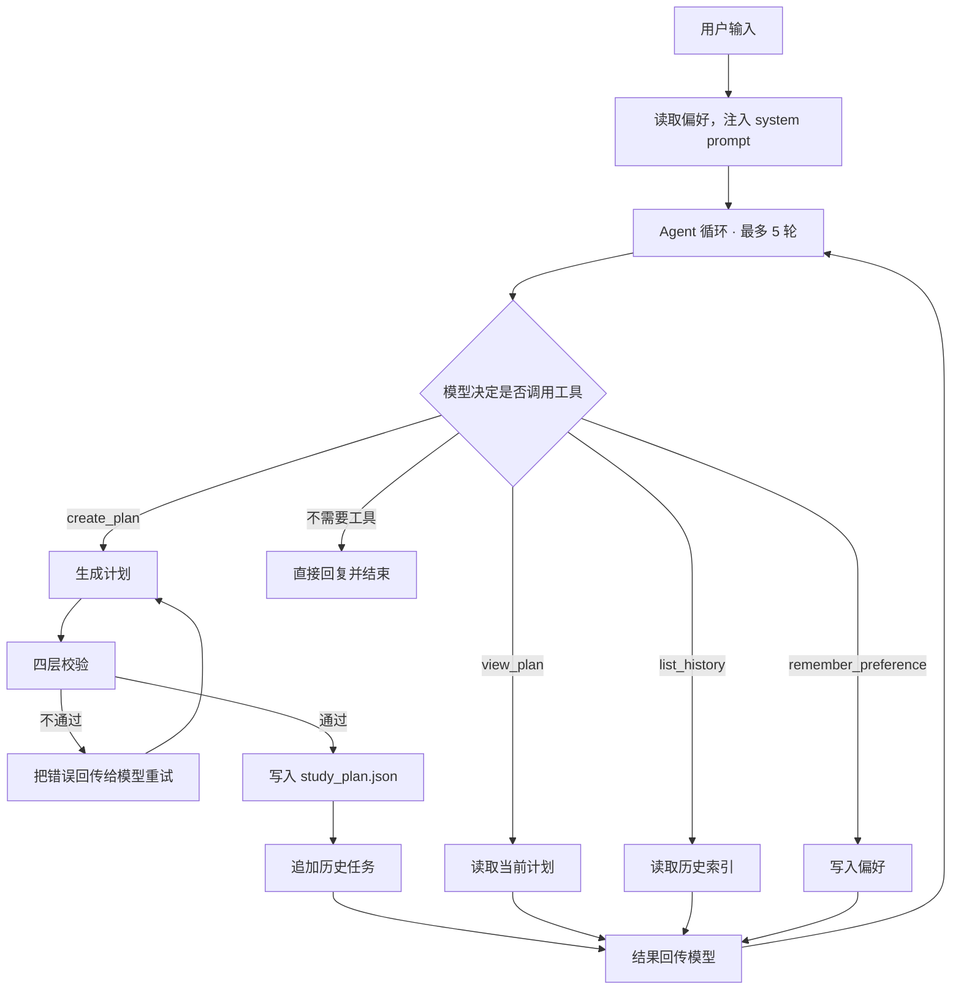

# 学习计划 Agent

一个**手写工具调用循环**的最小 Agent：根据你的学习目标、天数和每日时长上限，调用大模型生成逐日学习计划，经过四层校验后写入文件；也可以查看当前计划、查询历史任务，并记住你的长期偏好。

不使用 LangGraph、Dify 等现成框架，循环由自己实现，便于讲清"模型决定 → 程序执行 → 结果回传 → 继续思考"的全过程。

## 功能

- **生成计划**：说出学习目标和每天最多几小时，Agent 调用 `create_plan`，生成计划并保存到 `study_plan.json`
- **查看当前计划**：说"看看我现在的计划"，Agent 调用 `view_plan`，返回当前保存的那一份完整内容
- **查询历史**：说"我以前制定过哪些计划"，Agent 调用 `list_history`，返回最近几次任务的索引（目标、天数、时长）
- **记住偏好**：说"以后我每天最多学 2 小时"，Agent 调用 `remember_preference` 写入 `user_profile.json`，下次启动自动生效
- **能力边界**：与上述需求无关的请求，不调用任何工具，直接说明当前能力范围


## 项目结构

```
learning_plan_agent/
├── agent.py           # 编排层：4 个工具、Agent 循环、命令行入口
├── planner.py          # 能力层：模型调用、四层校验、错误回馈重试、保存
├── storage.py          # 数据层：读取已保存的计划
├── memory.py          # 记忆层：偏好 + 历史（按需查询、查询裁剪）
├── config.py           # 配置层：模型名、文件路径、API 客户端
├── requirements.txt    # 依赖清单（openai、python-dotenv）
├── .env                # 本地密钥，已写入 .gitignore，不提交
├── .gitignore
├── examples/
│   ├── study_plan.example.json    # 示例计划（演示用）
│   └── user_profile.example.json  # 示例画像（演示用）
├── README.md
└── docs/
    └── 项目介绍报告.md
```

依赖方向是单向的（箭头指向**被依赖方**，`A → B` 表示 A 使用了 B）：

```
agent ──→ planner ──→ config
  ├────→ storage ──→ config
  ├────→ memory  ──→ config
  └────→ config
```

三层职责：

- **config**：最底层，只提供模型名、文件名和 API 客户端，不引用任何项目模块
- **planner / storage / memory**：平级的三块能力，彼此互不引用，都只依赖 config
- **agent**：唯一的使用者，负责把它们串成一次工具调用

不存在循环导入。换模型或换文件名时，只需要改 `config.py`。

## 快速开始

环境要求：Python 3.12

```powershell
python -m venv .venv
.venv\Scripts\activate
pip install -r requirements.txt
```

在项目根目录创建 `.env`（必需）：

```
DEEPSEEK_API_KEY=你的密钥
```

缺少 `DEEPSEEK_API_KEY` 时，程序会在启动阶段直接提示配置缺失并退出。Agent 的所有功能都需要调用模型，没有离线模式（`python storage.py` 可单独查看计划，不调用模型，但同样要求 key）。

运行：

```powershell
python agent.py
```

启动后会提示：输入内容后按回车；按 Ctrl+C 退出程序。程序不识别任何退出短语。

示例对话：

```
你：以后我每天最多学 2 小时
（模型调用 remember_preference → 写入 user_profile.json）

你：帮我制定一个三天速成 C 语言的学习计划
（模型从偏好里取到"每天最多 2 小时" → 生成 → 校验 → 保存）

你：看看我现在的计划
（模型调用 view_plan → 读取当前计划）

你：我以前制定过哪些计划
（模型调用 list_history → 返回历史任务索引）
```

也可以单独运行 `python planner.py`，跳过 Agent 循环，直接测试"生成 + 校验 + 重试"这一层。

## 运行流程



`create_plan` 内部还有自己的小循环：最多生成 4 次，每次失败都把具体错误拼回对话，让模型针对性修正。

## 设计要点

| 机制 | 实现 |
|---|---|
| 循环与终止 | 最多 5 轮；单个工具最多 2 次；总调用最多 10 次。轮数用尽后追加一条系统指令，要求模型只做总结、不再调工具 |
| 工具失败处理 | 参数非法、未知工具、执行异常都会写成 `tool` 消息回传给模型，让它自行修正；次数受限，防止死循环 |
| 不谎报成功 | 工具的真实返回结果决定成功/失败，最后由 `show_execution_summary` 如实汇总 |
| 输出校验 | 第一层 JSON 解析 → 第二层字段类型（`hours` 必须是有限数字）→ 第三层天数（条目数必须等于用户要求）→ 第四层每日时长上限，每层错误都会回传给模型重试 |
| 配置集中 | 模型名、文件路径、API 客户端只在 `config.py` 定义一次；计划和画像固定写在项目目录，不受启动目录影响，密钥放在 `.env` |
| 记忆注入边界 | 提示词里只注入"偏好"和一句"有历史记录，需要时调用 list_history"，**不展开历史内容**，否则模型会绕过工具直接作答 |

## 记忆是怎么工作的

先把三样东西分开，它们是三种不同职责的数据：

| 数据 | 位置 | 职责 |
|---|---|---|
| 当前计划 | `study_plan.json` | **状态**：现在是什么 |
| 用户偏好 | `user_profile.json` 的 `preferences` | **记忆**：下次怎么做得更贴合你 |
| 历史任务 | `user_profile.json` 的 `history` | **日志**：你做过什么 |

工作方式：

- **读（偏好）**：每次 `ask_agent` 开始调用 `format_memory()`，把偏好拼成几行文本注入 system prompt。模型据此在用户没说时长时直接使用偏好。
- **读（历史）**：不在提示词里展开，只留一句存在性提示；用户问"以前做过什么"时，模型必须调用 `list_history` 去取。
- **写**：模型判断用户表达了长期偏好，调用 `remember_preference`；每次 `create_plan` 成功，程序自动追加一条历史，只保留最近 5 条。偏好 key/value 会去除换行与多余空白，并分别截断到 50/200 字符，避免注入系统提示词。
- **边界**：文件不存在、内容损坏或结构不正确时返回空画像，不会让主流程崩溃；记忆只保存偏好和任务摘要，不保存完整对话。

为什么历史不直接塞进提示词：一旦把内容摊在模型眼前，"查询历史"的工具就形同虚设——它会拿提示词里的信息冒充工具结果。这是本项目在自测中发现并修掉的设计问题。

## 常见问题

**改了 `.env` 里的 key，程序还是报 401？**
环境变量的优先级高于 `.env`，而它是在终端启动时确定的快照。修改 `.env` 后请**新开一个终端**再运行；若旧终端里已经存在同名变量，需要先清除或重启 IDE。

## 已知限制

1. **天数校验只统计条目数**：能保证"条数正确"，但不检查 `day` 标签是否从"第1天"连续编号、是否重复。
2. **只保留一份计划**：`save_plan` 覆盖写入，没有版本或历史。
3. **历史只有索引**：`list_history` 不返回每天的具体任务，且最多保留 5 条。


## 后续计划
- 增加 `day` 标签的连续性与唯一性校验
- 增加记忆查看/清除命令
